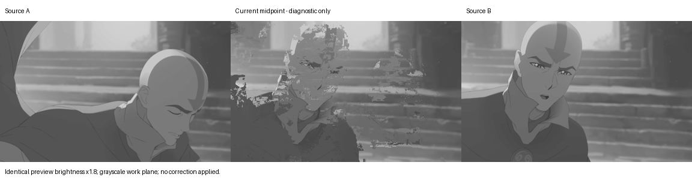

# Frame+ trajectory survival — phase 1, photometric evidence

## Result and decision boundary

The large pose change at Avatar 300 s remains visibly fragmented. In primary adjacent pair 4, all 25 fine-level patches with a distinguishable exhaustive photometric reference fail to evaluate a proposal within1.5 px of that reference. This supports investigating candidate generation, but **does not prove that25 semantically correct trajectories were missing**. An exhaustive patch minimum is not motion ground truth for occluded, flat, blurred or nonrigid surfaces. No phase 2 correction has been implemented.

The other controls show both losses during selection and losses after motion estimation. Four eligible samples around69 s and two around1082 s have reference-compatible forward and reverse fields and initial inverses, then use zero-displacement coordinates because the existing `still` protection fires. These are measured decisions, not six independently verified visible defects. Do not replace this observation with a claim that disabling static protection would improve quality.

The exact requested table of **correct physical trajectories** remains unproven. The tables below explicitly concern a photometric reference. They must not be used as semantic truth or as sole approval for a production fix.

## Scope and reproducible inputs

Only Core/Interpolation engines/tools and diagnostic assets changed. No other pipeline module or UI was edited by this task; preexisting UI edits were preserved. No playback selection, interpolation, projection, occlusion or blend rule was changed. No new external dependency was installed. CryptoKit, Metal and image export use system frameworks. Sources are never copied or transcoded as a movie.

Three persistent bounded windows,49 decoded endpoints each (48 intervals), were saved from the user-confirmed source `/Users/rafael/Downloads/Avatar.Aang.el.ultimo.maestro.del.aire.2026.WEB-DL.4k.HDR-Dual-Lat.mkv`:

| Case | Actual source PTS | Primary adjacent pair |
| --- | --- | --- |
| Avatar69 | 69.027–71.029s | 69.194–69.236s |
| Avatar300 | 300.008–302.010s | 300.175–300.217s |
| Provided18:02 | 1082.039–1084.041s | 1082.206–1082.248 s |

Exact PTS are authoritative in each `manifest.json`/`run.json`. The originals saved here are **uninterpolated, resampled work-plane luma**, UInt16 0…1023 at1152×480, not full native 4K color/HDR frames. ZIP archives losslessly retain those exact planes; per-plane SHA256 checks verify replay. PNGs are8-bit previews. The source movie itself remains unchanged.

Pan/background, crossing surfaces and blur are separate spatial masks in the69 s window, rather than three independent video sources. `regions.json` plus `region-mask.png` preserve the manually selected rectangles and sampling grid. These are diagnostic ROIs, not pixel-accurate defect/visibility annotations or surface tracks. The same coordinates are inspected in pairs2…6, so a moving face can leave a rectangle. Do not aggregate these observations as tracked facial trajectories.

The18:02 location supplied by the user is a Fire Nation landscape/bird shot in this source. The initial four sampled pairs are controls; the exact originally reported deformed pixel was not supplied. Pair6 crosses an independently inspected scene cut (`anime1082/cut6.png`). Its results remain saved but must be excluded from continuous-motion inference.

## Method

- Release on **Apple M4**, serial GPU runs; exact engine/configuration hashes in `assets/trajectory-survival-2026-10-17/execution.json`. SwiftPM uses Swift5 language mode; no concurrency/isolation setting was changed. The reusable dense engine and diagnostic callbacks require serialized access.
- A separate offline Metal kernel exhaustively evaluates integer displacements within ±256 work pixels (scaled radius at each level). It uses the same exposure normalization, Gaussian blur/downsample and8×8 SSD as the dense estimator, not a different image metric. It excludes target patches outside the image.
- A reference is *photometrically evaluable* when its minimum is finite, not on the search boundary, and its cost improves by>10% over the best candidate separated by more than2 px in either axis. All other samples remain exported and are excluded from the denominator. This test does not certify visibility, surface identity or nonrigid validity. No absolute residual or manual semantic certification is implied.
- L0 proposals/winners match within1.5work pixels. Every original seed/neighbor and iterative proposal evaluated inside `densePatchSearch`, both propagation passes, and coarse temporal selector is logged, including temporal proposals rejected by the central-cost gate. Four aggregation input proposals, the winner, reverse correspondence at the reference endpoint, confidence/hidden status, initial inverse coordinates, final coordinates/blend, and final static/support/ownership decisions are captured.
- `RIFT_DENSE_CANDIDATES=1` enables the separate diagnostic shader variant and bounded trace buffer. It defaults off; the macro compiles out of normal shaders. Observers otherwise remain unset. Trace synchronization/download is intrusive; **exclude all traced timings from performance measurements**.
- `never_evaluated_L0` means no reference-compatible proposal appeared in the recorded **fine dense** proposal sets. It does not mean the upstream block matcher never evaluated that displacement. Original block-matcher search internals are not instrumented by this change.
- `lost_before_synthesis` means a compatible fine-level proposal was observed but the final forward field no longer matches; loss events can include recovery and another rejection. `lost_at_synthesis` means the field matches but an active final source lookup does not. Per-level references are independently computed, so the coarse table is not proof of survival of a single semantic trajectory through all scales.

## Primary-pair table

Denominator is the evaluable subset, with excluded samples visible in the second column. “Missing/lost” below always refers to the photometric reference, not known correct motion.

| Region | Evaluable / sampled | Never evaluated L0 | Lost before synthesis | Lost in synthesis | Retained |
| --- | ---: | ---: | ---: | ---: | ---: |
| 69 s background/pan | 19/20 | 2/19 (10.5%) | 1/19 (5.3%) | 1/19 (5.3%) | 15/19 (78.9%) |
| 69 s crossing surfaces | 19/20 | 10/19 (52.6%) | 1/19 (5.3%) | 1/19 (5.3%) | 7/19 (36.8%) |
| 69 s foreground blur | 12/24 | 7/12 (58.3%) | 0/12 | 2/12 (16.7%) | 3/12 (25.0%) |
| 300 s face ROI | 15/20 | 15/15 (100%) | 0/15 | 0/15 | 0/15 |
| 300 s clothing ROI | 10/20 | 10/10 (100%) | 0/10 | 0/10 | 0/10 |
| 1082 s bird ROI | 24/24 | 1/24 (4.2%) | 0/24 | 1/24 (4.2%) | 22/24 (91.7%) |
| 1082 s landscape ROI | 17/20 | 2/17 (11.8%) | 0/17 | 1/17 (5.9%) | 14/17 (82.4%) |

Primary69 s pre-synthesis loss events are one aggregation rejection in the background ROI, and propagation1/2 rejections in one crossing-surface sample. The latter is one sample with two observed rejection events, not two lost blocks. No L0 temporal-selection loss is reported because the temporal selector intentionally runs only at levels 2/3. Coarse temporal losses are separately recorded in the full tables.

At300 s pair 4, independently searched references at levels 3/2/1/0 are evaluable in26/26/26/25samples; proposals appear in1/0/0/0 of them, and that single coarse match survives its coarse aggregation. Pair2 has the same broad lack of matches, while held/smaller-change pairs 3/5 have substantially more. Do not let those easier neighbors mask the failed transition; see every pair separately in [tables](assets/trajectory-survival-2026-10-17/tables.md).

A reference-radius sensitivity check at300 s with±384 px changes the best vector in4/40 L0 samples, although the evaluable cohort remains25 and all 25 still lack a compatible L0proposal. This was an **offline reference check**, not a widened production search or a proposed fix. The changing minima reinforce why these references cannot certify physical identity.

## Visual evidence

Source A / existing midpoint / source B, identical1.8×preview brightness, fixed union crop covering the face movement:



The midpoint visibly breaks facial, head and clothing contours. There is no corrected “after” image in phase 1. Traced/untraced interpolated pixels, both fields, reliability and inverse residuals are asserted identical, so instrumentation is not being presented as an image-quality change. Additional comparisons and full-work-plane endpoints are saved for69 s and1082 s. These are offline luma previews, not live GUI/HDR validation.

## Verification and reproduction

Run from the repository:

```sh
python3 Core/Interpolation/Tools/TrajectoryDiagnosticRun.py
```

This builds Release, restores only bounded plane archives if needed, checks all147 plane hashes, runs the known-translation/ambiguous-flat/observer tests in both compile variants, runs the existing dense and native regressions, then records15 adjacent-pair traces and JSON summaries. Large stage arrays are committed as deterministic `stages.json.gz`; the report reader accepts compressed traces without restoring raw JSON. All GPU work runs sequentially. Raw restored `.u16` files are locally ignored because lossless archives are committed.

Passed:

- Release MVProbe and Rift builds. Existing source warnings and FFmpeg minimum-OS linker warnings remain; this task does not claim compatibility with every macOS release from that build alone.
- Known +8 px translation oracle and rejection of flat ambiguous reference. Diagnostic on/off midpoint SHA256 is identical (`19d8ec18a4ba65ee0ed2bd1bb9c53a10eb09e70d83322613995b0ee67ea7eb1b`).
- Deterministic report fixture checks the four mutually exclusive categories and attribution of a known search rejection.
- Existing dense translation/endpoints/static/determinism, held/noisy neighbors, false-occlusion and known-visibility fixtures pass. Existing NV12/P010 native integration passes.
- Every real replay asserts identical output pixels, forward/backward fields, reliability and mapping residual with observers enabled versus disabled in the diagnostic variant.
- All147 source-plane archives pass integrity checks and match the saved plane hashes.

Optional radius sensitivity reproduction:

```sh
RIFT_DENSE_CANDIDATES=1 \
MV_TRAJECTORY_REPLAY="$PWD/docs/diagnostics/assets/trajectory-survival-2026-10-17/avatar300" \
MV_TRAJECTORY_RADIUS=384 .build/release/MVProbe
python3 Core/Interpolation/Tools/TrajectorySurvivalReport.py \
  docs/diagnostics/assets/trajectory-survival-2026-10-17/avatar300/pair_4_radius384
```

## Still unproven before a production correction

This is a reproducible **partial phase 1 diagnosis**, not resolution of the quality/performance objective. Correct physical trajectories and per-pixel visibility remain unverified in the deformed real regions. In particular, reference uniqueness within an8×8 blurred patch cannot distinguish a matching part of the background from the intended changing facial surface. Establish correspondences/surface ownership or an independent reference before reporting the requested semantic “never appeared versus lost” percentages as fact.

The current data also does not locate every loss relative to the entire upstream block search, establish one consistent reference across pyramid levels, or trace all backward candidates. It localizes observed fine/coarse proposal failures and exact forward synthesis decisions. More internal upstream/reverse instrumentation would be needed for a complete pipeline-wide attribution.

Native-color/GUI side-by-side quality, sustained 60 fps, p95 <35 ms with decode+Strong+presentation, pause/seek/resume/EOF, long-session thermals, EDR and Motion² equivalence have not been revalidated. No new temporal state or playback behavior was added, but passing isolated tests is not a substitute for those acceptance checks. No phase 2 implementation or fallback change is authorized by these measurements alone; stop here for review as requested.
